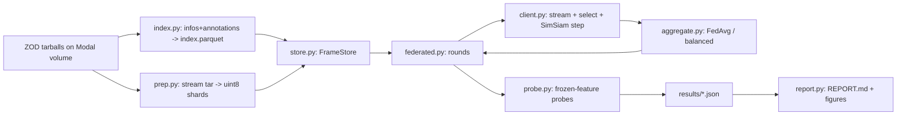

# Blueprint: Do the rare cases survive? Single-pass federated self-supervised learning on ZOD

Status: design written 2026-10-10 before any result exists. Results come only from the code in this repo; nothing here is a measured number.
Scope note (rule 7): a research repo. Sections that do not apply are collapsed in section 0 with the reason.

## 0. Collapsed sections
| Blueprint section | Decision | Why |
|---|---|---|
| Actors/roles, authn/authz, frontend, REST API, events, queues, DB server | Not needed | Offline batch experiments; one user; artifacts are files. Interfaces are Python function signatures and a CLI |
| LLM architecture | Not needed | No LLM component |
| Deployment | Modal functions + one volume | Heavy compute has no local GPU; no long-running service |
| Threat model | Short list in 12 | Realistic risks are licence, data leakage across splits, and secrets |

## 1. Executive summary
Question: when vehicles in different countries learn from their own stream of camera frames, **do rare, safety-relevant driving conditions (night, snow, fog, wet or icy road) survive federated averaging, and do single-pass data-selection rules and a condition-balanced aggregation change that?**

System: a simulator of a vehicle fleet on the Zenseact Open Dataset (ZOD) Frames. Clients are countries. Each client sees its frames once, in time order, with a tiny bounded buffer and no stored dataset (single pass). A client chooses which frames to learn from with a selection rule under a budget, trains a self-supervised (SimSiam) update on the chosen frames, and the server aggregates updates each round (FedAvg or condition-balanced). Representation quality is measured with frozen-feature probes on held-out frames, reported as mean and worst group, plus forgetting over time.

Key technical challenges: unknown tar layout (resolved after download), 8 MP images (pre-shrunk once into uint8 shards), non-IID countries, rare groups with few samples (confidence intervals), honest evaluation with few seeds.

## 2. Requirements
| ID | Requirement | Priority |
|---|---|---|
| F1 | Build a frame index (country, time, condition tags, labels) from ZOD infos/annotations | must |
| F2 | Shrink images once into fixed-size uint8 shards on the Modal volume | must |
| F3 | Simulate clients and rounds with single-pass streaming and a bounded buffer | must |
| F4 | Selection rules: all, random, loss-surprise, novelty, rarity | must |
| F5 | Aggregation: FedAvg and condition-balanced | must |
| F6 | Frozen-feature probes on held-out frames; mean, per-group, worst-group, per-country | must |
| F7 | Forgetting measure across time | should |
| F8 | Reference runs: untrained backbone, centralized training | should |
| F9 | Report generated from JSON, never typed by hand | must |
| N1 | Reproducible from seeds and config; one command per stage | must |
| N2 | Cost under the agreed cap of about 30 USD on Modal | must |
| N3 | Nothing hardcoded that is data (paths, class lists, thresholds come from config or the index) | must |
| N4 | No LiDAR/OXTS download; images stay on the Modal volume, not on the laptop | must |

## 3. Architecture


## 4. Components
| Component | Responsibility | Must NOT |
|---|---|---|
| config.py | Load TOML to validated dataclasses | Read env secrets, touch data |
| index.py | Parse ZOD infos/annotations tars to a table | Decode images |
| prep.py | One streaming pass over the image tar, resize, write shards | Keep full-resolution images |
| store.py | Random access to frames by row id | Know about federation |
| augment.py | Per-sample GPU augmentation | Use global RNG state |
| model.py | Frozen-BN ResNet-18, trainable layer3+layer4+head, SimSiam | Hold client state |
| selectors.py | Pick k of the arriving frames | Peek at future frames |
| aggregate.py | Combine client deltas | Know about images |
| client.py | One round of local single-pass training | Persist anything between rounds |
| federated.py | Rounds, evaluation schedule, run record | Contain algorithm details |
| probe.py/metrics.py | Probes and group metrics with bootstrap CIs | Train on stream frames |
| report.py | Render JSON to Markdown/PNG | Contain numbers |

## 5. Data
Source: ZOD Frames (CC BY-SA 4.0), files `images_front_blur.tar.gz` (48.0 GB), `annotations.tar.gz` (1.45 GB), `infos.tar.gz` (0.60 GB). Attribution is kept in the README.

`index.parquet` (one row per frame), exact columns finalized after inspecting the tars (decision recorded in ADR-6):
| field | type | notes |
|---|---|---|
| frame_id | str | key |
| country | str | from infos `country_code` |
| ts | float | collection time; defines stream order |
| tod, weather | str | from infos; define condition groups |
| cond | str | `tod/weather`, merged by config thresholds |
| label_* | varies | probe-task labels from annotations |
| split | str | `stream`, `probe_train`, `probe_test`; fixed by seed, stratified by country |

Leakage rule: probe frames are never in any client stream. A test asserts the splits are disjoint.

## 6. Algorithm
Per round r (a fixed slice of the timeline), each client k with frames in the slice:
1. Frames arrive in time order in arrival batches of size a.
2. Selector scores the batch and keeps k_sel = max(1, round(B*a)) frames (B = budget; B=1 keeps all).
3. Kept frames enter a bounded buffer (max 63). When it holds at least 32, one SGD step on a SimSiam loss is taken and the buffer is cleared. A final step is taken if at least 8 remain. Frames are never revisited.
4. The client returns the parameter delta, n_kept, and a histogram of kept frames per condition.

Server: weights for FedAvg are n_kept. Condition-balanced weights give each condition equal total weight: w_k proportional to sum over c of n_kc / N_c, then normalized. Conditions with N_c = 0 are ignored. Global update = global + sum w_k delta_k.

Selection rules: `random`; `loss` = highest per-sample SimSiam loss; `novelty` = farthest from the client's running feature mean (EMA, no stored images); `rarity` = sampling with probability proportional to 1/q(cond) using the publicly shared global condition frequency q.

Evaluation: after selected rounds, extract frozen 512-d features for probe frames and fit a logistic regression on probe_train for each task; report accuracy/macro-F1 overall, per condition group, worst group, per country, with bootstrap CIs. Forgetting for a group = best score earlier minus final score.

Hypotheses (written before results):
- H1: condition-balanced aggregation and rarity selection raise worst-group probe score versus FedAvg+random at equal budget, without lowering the mean by more than the seed noise.
- H2: surprise-based selection (loss, novelty) increases forgetting of groups seen earlier.
- H3: every federated variant stays below the centralized reference.
Negative or null results are reported as found.

## 7. Failure and recovery
| Component | Failure | Detection | Recovery |
|---|---|---|---|
| Torrent/Dropbox download | No peers, wrong link | aria2 CN:0 or Dropbox not_found | Report; user supplies link; do not substitute other data |
| prep | Corrupt JPEG | PIL error | Log frame_id, skip, count in manifest; fail if more than the configured fraction |
| Run | Container preempted | Modal retry | Runs are independent; results written per run; rerun missing ones |
| Client | No frames in a round | n=0 | Skipped, logged |
| Probe | Group has fewer than the configured minimum | count check | Group reported as `n/a`, never imputed |
| Volume | Uncommitted writes lost | missing files | Explicit `commit()` after each stage |

## 8. Testing
Unit: selectors respect budget and ordering; balanced weights give equal total weight per condition (property test); FedAvg weights sum to one; bounded buffer never exceeds its cap; frames are consumed once; splits disjoint; determinism for a fixed seed; augmentation shape and range. Integration: a tiny end-to-end federated run on synthetic data with a small random model must reduce SimSiam loss and produce a complete result file. Scientific sanity: probe on random labels is near chance; the untrained backbone reference is reported next to every trained result.

## 9. Configuration
Everything tunable lives in `config/default.toml`: data paths and image size, number of rounds, client definition, arrival and training batch sizes, learning rate, selection kind and budget, aggregation kind, evaluation schedule, probe tasks and minimum group size, seeds. Secrets (the ZOD link) live only in the Modal secret `zod-download` and are never written to files.

## 10. Repository structure
```
config/default.toml        all knobs
src/zodfl/                 library (modules in section 4)
tests/                     pytest, synthetic data only
modal_torrent.py           data fetch (torrent route)
modal_download.py          data fetch (Dropbox route)
modal_app.py               GPU entrypoints: smoke, prep, run, grid
docs/BLUEPRINT.md          this file
results/                   JSON per run, REPORT.md, figures (generated)
```

## 11. Dependencies
torch/torchvision (model, augmentation), numpy/pandas/pyarrow (index), scikit-learn (probes), Pillow (decode), bencodepy/requests/aria2 (fetch only), pytest. No federated framework: the simulator is about 200 lines, and Flower/FEDn would add deployment machinery without changing the science. FEDn/Flower is listed as future work.

## 12. Risks
| Risk | Consequence | Mitigation |
|---|---|---|
| Rare groups too small | Noisy worst-group numbers | Minimum group size, bootstrap CIs, say so |
| Few seeds | Weak statistics | 3+ seeds, report spread, avoid significance claims |
| SimSiam collapse | Meaningless features | Monitor feature std; untrained and pretrained references |
| ImageNet-pretrained init | Differs from "from scratch" | State it; the question is adaptation of a shipped model |
| No peers for the torrent | No data | Dropbox route; stop and report |
| Licence | Misuse | CC BY-SA 4.0 attribution; no redistribution of frames; faces/plates are already blurred in the used images |

## 13. ADRs
1. **Simulator in plain PyTorch, not Flower/FEDn.** Alternative: framework. Chosen for control and speed; revisit for deployment.
2. **Clients = countries.** Alternatives: random IID clients (no real non-IID), per-drive clients (ids not confirmed). Countries are the real heterogeneity in ZOD.
3. **ImageNet-pretrained ResNet-18 with frozen BatchNorm, train layer3+layer4+head.** Alternative: from scratch (too weak for a one-night budget).
4. **SimSiam.** Alternatives: BYOL (EMA state per client), contrastive (needs big batches). SimSiam is stateless per client and works with tiny kept batches.
5. **Probes, not fine-tuning, for evaluation.** Isolates the representation and keeps cost low.
6. **Label tasks and condition groups finalized after inspecting the tars.** The ZOD file layout is not known until downloaded; guessing would be a silent assumption.
7. **Single pass with a bounded buffer instead of a replay buffer.** Matches the "transient data, no hoarding" setting of the target projects.

## 14. Definition of done
- Data indexed and sharded; counts per country/condition recorded in `results/data_summary.json`.
- All must-requirements implemented; tests pass.
- Reference runs and the grid completed, or the missing ones listed.
- `results/REPORT.md` and the README results block are generated from JSON.
- README states limitations, the pretrained-init choice, and what was not tested.
- No result is typed by hand; no fake data in production paths.

---

## 15. Decisions made while building (2026-10-12), with the evidence

All numbers below come from pilot runs on seed 100 (never used in the final seeds 0-2) and are label-free training-health checks, not accuracy comparisons.

| # | Decision | Why (evidence) |
|---|---|---|
| ADR-8 | SimSiam heads use BatchNorm1d (batch statistics only), not LayerNorm | First pilot with LayerNorm heads: loss fell from -0.63 to -0.997 within two rounds (trivial agreement) and feature spread dropped from 0.0200 to 0.0114. SimSiam relies on BatchNorm in its heads |
| ADR-9 | Pretrained layer3/layer4 learn at `local_lr * 0.003` (heads at `local_lr`) | With one shared learning rate the effective rank of the features fell from 90.9 to 2.4 after 6 rounds. Multiplier sweep, effective rank after training (start 90.9): 6 rounds, 20% random: 0.1 -> 10.9, 0.03 -> 51.5, 0.01 -> 78.0, 0.003 -> 87.3. Hardest case, all frames for 24 rounds: 0.03 -> 14.2, 0.01 -> 42.8, 0.003 -> 71.5. Rule fixed in advance: keep at least half the starting rank in the hardest case; 0.003 is the only tested value that does |
| ADR-10 | Add a low-label probe (10% of `probe_train`, fixed subset) next to the full probe | In every pilot, full-label probe scores stayed within about 0.01 of the untrained backbone, so full-label probes are insensitive to small representation changes |
| ADR-11 | Rounds are slices with equal numbers of stream frames | Collection is clustered in time; equal-width slices would be mostly empty |
| ADR-12 | Clients are countries | ZOD has only 5 collection cars, each driving in 6-11 countries; countries are the real non-IID units |
| ADR-13 | Condition group = road condition x light (6 groups) | Smallest group (snow at night) has 262 probe-test frames, enough for a worst-group number with a bootstrap interval |
| ADR-14 | Stage 2 uses image-level proxy tasks, not object detection | Finishable and comparable across architectures; detection with ZOD's 2D boxes is the stated next step |
| ADR-15 | Stage 2 "transition cars" carry both camera generations, so the teacher reads the old view | Otherwise the teacher would be handicapped by the new, worse sensor; configurable with `stage2.teacher_sees` |

### Stage 2 (generation gap), as implemented
Generations: A = ResNet-18 at 144x256 (PL, DE, FR), B = MobileNetV3-small at 108x192 with a 0.9 field of view (SE, GB, IE, CZ), C = MobileNetV3-small at 72x128, 0.8 field of view, 8-bit weights (IT, NO, HU, NL, LU). Teacher A is trained with labels (federated, FedAvg). B variants: `floor` (1% labels), `oracle` (all labels), `kd_incar` (teacher-in-the-car), `kd_incar_rarity` (same with weight (1/q)^0.5 on rare conditions), `kd_public` (server-side distillation on 3000 shared frames). C variants: `oracle`, and `kd_incar` / `kd_incar_rarity` distilled from the matching B (the telephone game). All models are scored on the same held-out probe-test frames from every country.

Not implemented: ensemble of per-country teachers, reverse transfer from B to A, real hardware quantization (weights are fake-quantized), detection heads.

### Headline choice (fixed 2026-10-12 before any grid or stage-2 result)
Primary task: `vru_present` (pedestrian or vulnerable vehicle visible). Primary metric: worst-group accuracy over the six road-condition x light groups, reported for the full-label probe and the low-label probe. Everything else (other tasks, per-country tables, mean-group accuracy) is secondary and lives in `results/REPORT.md`. Reference runs for comparison: `init` (no training) and `central_all`. The paired baseline for differences is `fedavg_random20`.

### ADR-16: stage-2 training recipe (2026-10-12)
The first stage-2 attempt (seeds 0-2, archived on the volume as `attempt1_stage2`, not reported) had one diverged teacher (seed 1: 0.328 overall on the pedestrian task and 0.095 on road type, below chance, consistent with non-finite outputs; every student copied it) and weak teachers on the other seeds (worst-group 0.45-0.49). Changes: gradient clipping (norm 5), steps with a non-finite loss or gradient are skipped and the run fails if more than 2% are skipped, and the pretrained body learns at `lr * backbone_lr_mult`.

`backbone_lr_mult` was chosen on a different seed (100) and on the validation split (`probe_train`), never on `probe_test`. Rule fixed in advance: highest mean over the four tasks of worst-group accuracy. Result (validation score; 4 candidates, no skipped steps): 1.0 -> 0.4776, 0.3 -> 0.4563, 0.1 -> 0.4621, 0.03 -> 0.4834. The spread is small and non-monotonic, so the recipe is not very sensitive; 0.03 was chosen by the rule. Final stage-2 results use seeds 0-4.

---

## 16. Phase 2: follow-up studies (hypotheses written 2026-10-12, before any phase-2 run)

Same data, same seeds (0-4), same headline (task `vru_present`, worst-group accuracy over road condition x light), reported for the full-label and the low-label probe. Comparison anchors: `init` (no training) and `fedavg_random20` / `fedavg_all`.

**P5. Published aggregation methods on this setup.** Variants: `ldawa` (layer-wise cosine weighting, Eq. 5 of Rehman et al. 2023 as read from the paper's HTML text; the weights are not normalized, as in the paper), `ldawa_norm` (the same weights normalized to sum to 1), and `fedema` (client keeps its online model between rounds, EMA toward the global model with mu = min(lambda * ||w_g - w_k||, 1), lambda autoscaled with tau = 0.7, Zhuang et al. 2022; applied to SimSiam, not BYOL, so it is a FedEMA-style variant). Each at the 20% random budget and with all frames.
- H5a: `ldawa` is practically identical to `fedavg`, because client updates are small and the cosines are close to 1.
- H5b: neither method removes the adaptation tax (they stay below `init` on the low-label worst-group).

**P1. The adaptation tax.** Variants at the 20% random budget and with all frames: `layer4only` (layer3 frozen), `anchor` (L2 pull of the pretrained layers toward the shipped weights, mu in {0.1, 1.0, 10.0}; 10.0 added before any run because 0.1 and 1.0 may be too weak at this learning rate), and `interp` (evaluate the weights interpolated between the shipped model and the trained one, alpha in {0.25, 0.5, 0.75}). Also a free analysis: worst-group over rounds from the existing checkpoints.
- H1a: the tax accrues gradually with rounds.
- H1b: `interp` recovers most of the lost low-label worst-group accuracy at some alpha < 1.
- H1c: `layer4only` and `anchor` reduce the tax; any reduction is bought with less adaptation.

**P6. Reverse transfer (stage 2).** A' = teacher A distilled from the new-market model B (trained with true labels on generation-2 countries) on generation-1 cars' own frames; also an anchored variant whose targets average A's and B's predictions. Scored per country group (generation 1 = retention, generation 2/3 = new knowledge).
- H6a: naive reverse transfer improves A on generation-2 countries.
- H6b: it costs accuracy on generation-1 countries; the anchored variant costs less.

**P4. Detection (RISE-literal version).** Specified when built (section 17).

Implementation notes found while testing P5 (2026-10-12): the L-DAWA formula as printed (Eq. 5) is undefined for a layer whose global weights are all zero (the cosine has no direction; BatchNorm biases start at zero) and gives a negative weight to a client with a negative cosine. `ldawa` keeps the printed formula and takes cosine = 1 for an all-zero global layer; `ldawa_norm` is our own safer variant (negative cosines clamped to 0, weights normalized, FedAvg fallback). FedEMA is applied to SimSiam, not BYOL, and the formulas come from the papers' HTML text as returned by a fetch tool, not from reading the PDFs.

## 17. Detection study (RISE-literal version; written 2026-10-13, before any detection run)

**Why this scope.** ZOD objects are small: in the 3848x2168 camera image the median pedestrian is 21 px wide and 57 px tall, the median vehicle 62 x 39 px (measured on 1,500 frames, `modal_det_inspect.py`). The 144x256 shards used so far shrink a pedestrian to about 1 px, so detection needs its own image store. 100k frames at a usable size will not fit anywhere cheap, so detection uses a fixed subset.

**Data (ADR-17).** 960x540 JPEG (factor 4 of the original), 11,659 frames: 3,000 training frames from each generation's countries (the `stream` split of `stage2.gen_countries`, sampled with weight count^-0.5 per condition group so rare groups are over-represented; this changes the training mix and is stated), 500 validation frames (`probe_train`, for recipe choices) and up to 400 test frames per condition group from `probe_test` (2,159). Boxes: the 4 corners of ZOD's object_detection.json reduced to an axis-aligned box; classes Vehicle, VulnerableVehicle, Pedestrian; `unclear` objects dropped; boxes smaller than 3x4 px at 960x540 dropped. Result: 159k boxes (122k vehicles, 15.5k vulnerable vehicles, 21k pedestrians).

**Models (ADR-18).** Faster R-CNN with FPN. Generation A: ResNet-18 backbone, input 960x540. Generation B: MobileNetV3-small backbone, input 640x360 (cheaper chip and camera). Same small-anchor layout (8-256 px), ImageNet-pretrained backbones, frozen BatchNorm, SGD with cosine decay, mixed precision, a step with a non-finite loss is skipped and counted (more than 2% aborts the run).

**Comparison (per seed, 3 seeds).** `det_A_teacher` (labels, generation-1 frames); `det_B_oracle` (labels, generation-2 frames); `det_B_floor` (labels on 10% of them); `det_B_kd_incar` (no labels: the teacher's boxes with score >= 0.5 on generation-2 frames are the targets); `det_B_kd_floor` (labels on the 10%, teacher boxes on the rest). Scored on the same test frames: COCO-style AP (own implementation, 101-point, IoU 0.50:0.95) and AP50, overall, per class and per condition group, with the worst group. Boxes are hard pseudo-labels, not soft distillation: the simplest transfer that crosses a change of architecture.

**Pre-registered expectations.**
- H4a: `det_B_kd_incar` has higher worst-group AP than `det_B_floor`.
- H4b: `det_B_oracle` has higher AP than `det_B_kd_incar` (labels still help).
- H4c: the teacher's errors on rare groups carry over: the gap between `det_B_kd_incar` and `det_B_oracle` is larger in wet/night and snow groups than in normal/day.
- Not tested here (stated limitation): federated self-supervised pretraining for detection (stage 1 of the classification study), because the stage-1 backbones are 144x256 models and were not saved; a second generation (C); soft distillation.

**Recipe.** Chosen on the validation frames of one separate seed (100) before any test number is looked at: learning rate and epochs, from the loss curve and validation AP of the teacher, oracle and kd runs.

**Outcome (2026-10-13; 3 seeds, test frames).** Recipe chosen on validation frames of seed 100: more epochs did not help (teacher AP 0.135 at 6 and at 10 epochs), upsampling the input (teacher 756 px short side, student 504 px) did (0.157 and 0.068 on validation), so that recipe was fixed before the test run. Test AP: teacher 0.136, `det_B_oracle` 0.062, `det_B_floor` 0.009, `det_B_kd_incar` 0.069, `det_B_kd_floor` 0.069. H4a holds (kd minus floor +0.060, 95% CI +0.058 to +0.062; worst-group +0.043). H4b fails: the student on teacher boxes beat the student on true labels by 0.007 (95% CI +0.002 to +0.012); cause not tested. H4c: no evidence of a larger gap in rare groups. Caveat: the floor got the same epochs as the others (about 10x fewer steps), so it is nearly untrained and the gap-closed ratio (about 1.14) is inflated.
